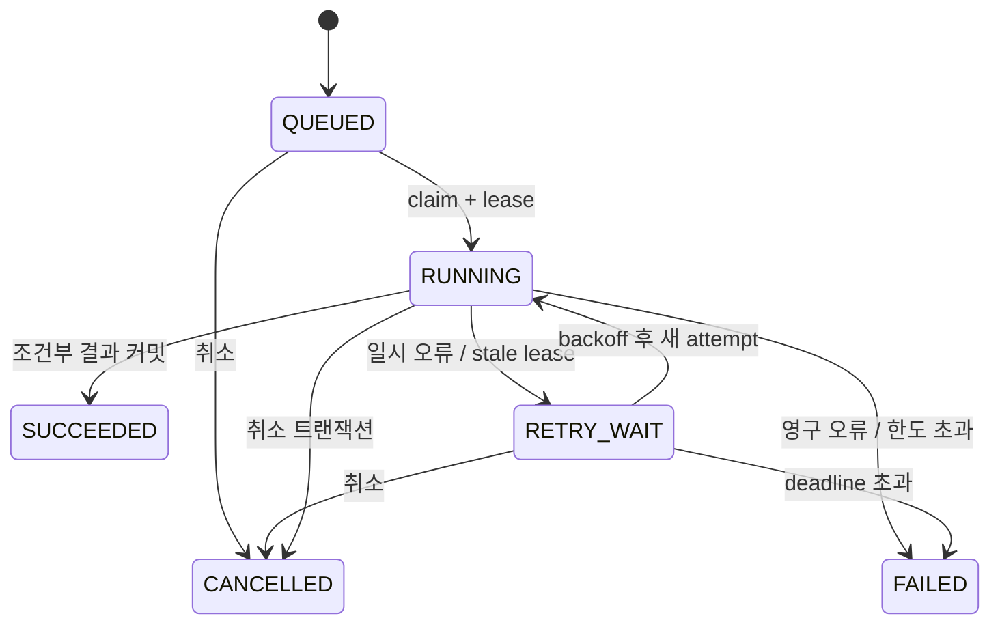

# AI Agent 및 비동기 작업 설계

LangGraph가 학습 상담 흐름을 실행하고 LangChain Ollama 어댑터가 모델을 호출한다. Spring은 작업·세션·게시의 권위를 소유한다. Python worker는 생성 실행자다.

## 세션·작업 상태

세션은 `OPEN → CLOSED` 또는 `OPEN/CLOSED → DELETING → DELETED`로 전이한다. CLOSED는 신규 질문만 차단하고 진행 중 작업과 이력 조회를 허용한다. DELETING부터 조회·새 작업·결과·파생 게시를 차단한다. UI 이동·브라우저 종료는 상태 변경이 아니다.

작업 상태는 다음과 같다.

SUCCEEDED/FAILED/CANCELLED는 불변 terminal이다. 작업 종료와 메모리 추출은 분리하며 추출 실패로 정상 답변을 실패 처리하지 않는다. 사용자 취소는 DB에서 즉시 논리 확정할 수 있고 실행 프로세스 중단은 협력적으로 진행한다. 이미 성공 커밋된 작업은 취소 API로 소급 취소하지 않는다.

## 동일 thread 직렬화

session 행 잠금으로 job.seq를 발급한다. claim은 가장 작은 비종료 seq만 허용한다. RETRY_WAIT는 뒤 작업을 막으며 최대 재시도/전체 deadline을 지나면 FAILED 처리해 다음 작업을 진행한다. 초기 후보는 lease 60초, heartbeat 15초, 최대 3회, 총 deadline 5분이며 모델 평가 후 조정한다.
DB thread lease가 현재 job과 단조 fence를 소유한다. Redis lock/consumer group은 보조 도구이며 단독 권위가 아니다. worker 장애 후 새 claim은 attempt와 fence를 증가시킨다. 오래된 worker의 heartbeat·preview·결과·기억 게시·checkpoint head 갱신을 거절한다. 물리적으로 중복 계산이 잠시 발생해도 유효한 상태 전이는 한 실행만 수행한다.

## Agent 노드

1. 작업 claim, session generation과 학생 scope를 확인한다.
2. 이전에 게시된 checkpoint head를 불러온다. 만료 시 학생 정책을 적용한 최소 context로 재시작하고 무제한 원본 재수화를 하지 않는다.
3. 요청 안전성·주제·명시적 정정 의도를 분류한다.
4. 권한이 검증된 장기 기억·Vector RAG·GraphRAG를 제한적으로 조회한다(해당 단계 활성화 후).
5. rolling summary·최근 메시지·검색 자료·출력 예산을 구성하고 필요 시 압축한다.
6. Ollama 응답을 임시 스트리밍한다. 노드·토큰 batch 경계마다 취소·lease를 확인한다.
7. 응답·인용·길이를 검사하고 candidate checkpoint를 작성한다.
8. Spring result API로 답변과 candidate head를 제출한다. 수락 후 final Outbox, 추출 예약, TTL 수명 관리가 이어진다.

도구는 범위 제한된 검색만 허용한다. 임의 SQL/Cypher·파일·shell·웹 탐색 도구를 학생 입력이나 모델 출력에 개방하지 않는다.

## 결과 원자성과 취소 경합

결과 API는 `student memory control → session → thread lease → job` 순서로 행을 잠근다. `session.generation == job.generation`, 세션 비삭제, RUNNING, 현재 attempt/fence, 유효 lease, 사용자 계정 활성 조건을 모두 검증한다. 기억 도입 후에는 claim 시 받은 context_memory_epoch가 현재 값과 같은지도 검사한다. 기억 수정·삭제와 경합하면 오래된 context의 결과를 게시하지 않고 재구성/재시도한다. answer unique(jobId), resultHash, 상태 SUCCEEDED, accepted checkpoint head, Outbox를 같은 트랜잭션에 저장한다. 다른 결과 hash는 충돌이다.
취소·삭제도 같은 잠금 순서를 사용한다. 기억 제어 행을 포함하는 복합 트랜잭션은 항상 학생 제어 행부터 잠가 역순 교착을 막는다. 먼저 커밋한 상태가 승리한다. 취소가 먼저면 뒤 결과는 폐기되고, 성공이 먼저면 취소 요청은 기존 SUCCEEDED를 반환한다. 세션 삭제는 generation 증가, 모든 비종료 작업 취소, head 차단, cleanup job/outbox를 원자 기록한다. tombstone은 원본 삭제 후에도 유지한다.

## Checkpoint 격리와 재생성 차단

표준 Saver만으로 stale worker의 쓰기를 막았다고 가정하지 않는다. 각 실행은 서버가 발급한 `thread/generation/attempt` namespace에서만 쓰고, 다음 작업은 DB가 수락한 head만 읽는다. 결과 거절된 namespace는 항상 읽기 불가다.
checkpoint adapter는 쓰기 직전 generation/fence를 확인하고, Redis의 fence/tombstone을 같은 원자 관문으로 검사한다. 라이브러리의 직접 쓰기 경로 전체를 감쌀 수 있는지 6단계에서 검증한다. 검증 전에는 이 기능을 완료 처리하지 않는다. 삭제 시 쓰기 관문 폐쇄 후 worker 정지 확인·namespace 전체 정리를 재시도한다. Redis 유실·복구 시 DB tombstone/fence를 먼저 복원하고 체크포인트 writer를 개방한다.

## 큐·재시도·복구

Streams는 consumer group, XACK, pending reclaim을 사용한다. read 후 장애는 재처리한다. terminal DB 상태를 확인한 중복 이벤트는 실행하지 않고 ack한다. 선행 seq가 남은 작업은 지연 예약하고 busy loop하지 않는다. 일시 오류는 backoff+jitter, 입력/권한 오류는 즉시 종료, 한도 초과는 DLQ와 DB FAILED로 남긴다. 운영 재처리는 현재 권한·세대를 다시 검증하며 취소·삭제 작업을 부활시키지 않는다.
Outbox 미발행, QUEUED 장기 대기, stale RUNNING을 DB reconciler가 감시한다. Redis stream trimming은 PEL/재처리 보장 범위를 고려하고 미처리 항목을 단순 MAXLEN으로 삭제하지 않는다.

## 스트리밍

조각은 attempt+seq로 중복 제거하고 provisional로 표시한다. 실패·취소 시 조각을 폐기하고 최종 답변으로 저장하지 않는다. reconnect는 DB job 상태와 완성 답변을 조회한다. preview 전체 재생은 초기 보장 범위가 아니다. 네트워크 이탈이나 세션 close 이후에도 성공 답변은 저장되며, 세션 delete 이후에는 저장되지 않는다.
