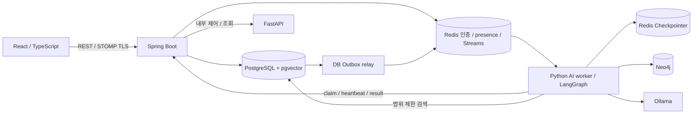

# 시스템 아키텍처

상태: 검토용 초안. 초기 배포는 모듈형 Spring Boot 애플리케이션, 내부 FastAPI, 별도 Python worker를 사용한다.

## 책임 및 배포 경계

| 구성요소 | 책임 | 금지 |
| --- | --- | --- |
| frontend | 역할별 UI, cursor 동기화, 임시 스트리밍 표시 | DB·FastAPI 직접 접근 |
| Spring common/identity | 인증, 담당 관계, 알림, 오류 계약 | 학생 역할 자기 승격 |
| Spring chat | 일반 방·원본·읽음·인가 | 일반 대화 AI 자동 수집 |
| Spring aichat | 세션·작업·순번·결과·취소·삭제의 권위 | worker 결과 무검증 저장 |
| FastAPI | 내부 readiness, Agent 설정 조회, 제어 신호·삭제 처리 | 외부 클라이언트 진입점 |
| worker | Streams 소비, LangGraph, 요약·추출·검색·생성 | 회원·일반 채팅 테이블 직접 쓰기 |
| Outbox relay | 커밋된 이벤트를 Streams/알림으로 전달 | DB와 Redis 이중 쓰기 성공 가정 |

프로세스 내 background task로 장기 AI 작업을 수행하지 않는다. FastAPI 재시작과 worker 수명은 분리한다. Spring에서 일반·AI 모듈 간 Entity/Repository를 공유하지 않고 식별자·서비스 계약을 사용한다.

## 저장·전달 경계

1. Spring은 인증·학생 범위를 확인하고 세션 행을 잠근다. 원본 질문, job, thread 순번, Outbox를 하나의 PostgreSQL 트랜잭션에 저장한다.
2. Relay는 DB 행을 `SKIP LOCKED`로 임대하고 eventId를 포함해 XADD한다. XADD 후 DB 갱신 전 장애는 재발행될 수 있으므로 중복 허용·소비 멱등성을 전제로 한다.
3. Worker는 최소 데이터(jobId/eventId)로 작업을 가져와 내부 claim API에서 실행 권한·정규 입력·fencing token을 받는다. PEL 회수는 소유권을 보장하지 않는다.
4. 결과는 Spring 내부 API로 제출한다. 같은 session/job 잠금 아래 세대·lease·시도·취소 여부를 확인하고 답변·상태·Outbox를 원자 저장한다. 영구 final 이벤트는 그 이후만 발행한다.
5. Worker는 결과가 DB에서 수락되었거나 이미 종료된 작업임을 확인한 뒤 XACK한다. DB reconciliation은 Outbox 미발행·stale lease·사라진 stream entry를 재구성한다.

## 실시간 확장

일반 메시지와 AI final 알림은 durable Outbox를 거친다. 초기 Spring 1 replica에서는 로컬 STOMP broker와 Redis 이벤트 consumer를 연결한다. 다중 replica에서는 각 replica에 fanout해야 한다. 하나의 consumer group만 공유하면 특정 노드의 연결에만 전달되는 오류가 생기므로 replica별 전달 또는 외부 STOMP broker로 전환한다. 클라이언트는 항상 DB cursor 재조회로 누락을 복구한다.
AI token 조각은 비영구 Redis stream/채널에서 전달 가능하나 DB 메시지로 취급하지 않는다. 느린 구독자는 조각을 합치거나 버리고 최종 답변으로 수렴한다.

## 장애·운영 원칙

- PostgreSQL 불가: 쓰기 수락하지 않는다. Redis 불가: 이미 커밋된 Outbox를 보존하고 지연 처리한다. 인증 상태 확인 실패는 거절한다.
- Redis queue는 AOF와 noeviction, DB reconciliation을 사용한다. checkpoint Redis는 별도 인스턴스로 메모리 압박과 키 수명을 격리한다.
- Neo4j 장애는 허용된 vector-only 답변으로 낮추고, 검색 전체 실패는 자료 근거가 없음을 표시한다. 학생별 접근 검증 실패는 fallback하지 않고 거절한다.
- 내부 포트는 Compose 네트워크에만 노출한다. 로컬 Ollama는 컨테이너에서 host gateway로 접근할 수 있으나 방화벽·바인딩·인증 프록시를 확인한다.
- UTC timestamptz 저장, UI는 Asia/Seoul 변환. correlationId, jobId, eventId, queue age, retry, lease 경합, context token, 검색 지연을 계측한다. 로그에 대화·토큰·개인 기억을 남기지 않는다.
- 각 저장소는 백업·복구 절차를 별도 검증한다. tombstone/삭제 ledger를 복구 후 재적용하기 전 서비스를 개방하지 않는다.

## 주요 위험과 대응

| 위험 | 대응 | 확인 단계 |
| --- | --- | --- |
| 취소/삭제 후 늦은 게시 | DB 세대·fence 검사, attempt namespace 격리, 게시 관문 | 5~8 |
| 중복·순서 역전 | DB unique, 순번, lease, 재시도 backoff | 3~5 |
| Checkpointer 키 재생성 | 실행 시도별 격리, tombstone·쓰기 차단·반복 정리 | 6 |
| 모델 메모리·지연 | 하드웨어 확인, 동시성 1 시작, 평가 후 확대 | 1·4 |
| 다중 저장소 삭제 부분 실패 | durable cleanup job, 즉시 논리 차단, 재시도·감사 | 8~10 |
| 의존성 major 충돌 | BOM/lock/digest, 실제 조합 smoke test | 1 |
